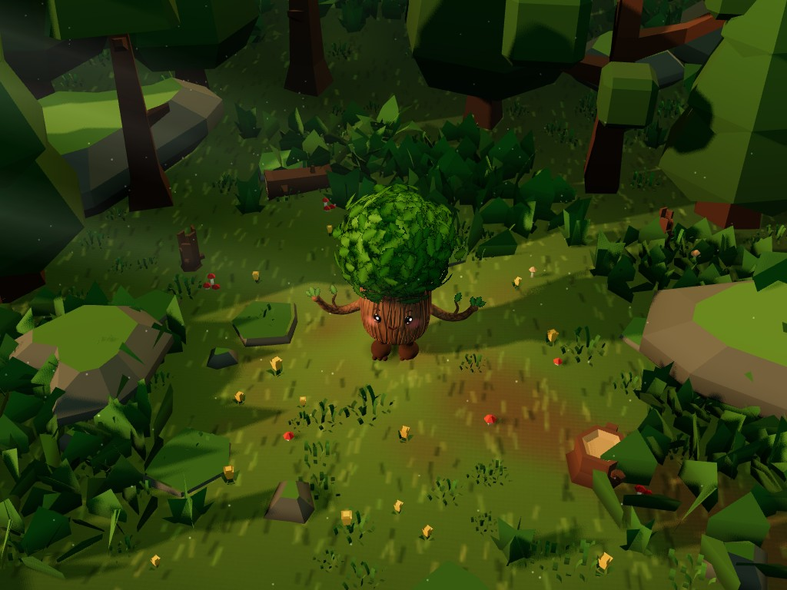
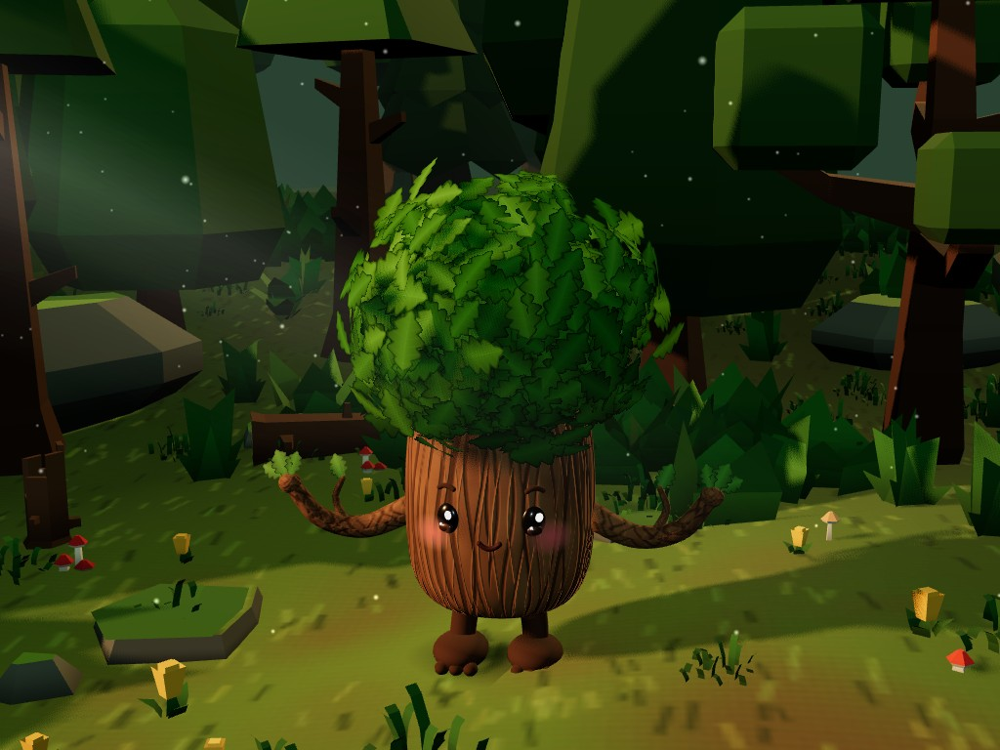
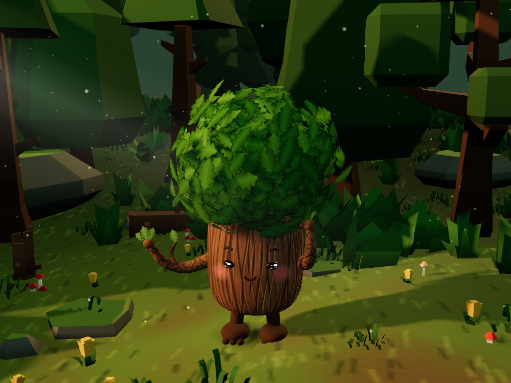
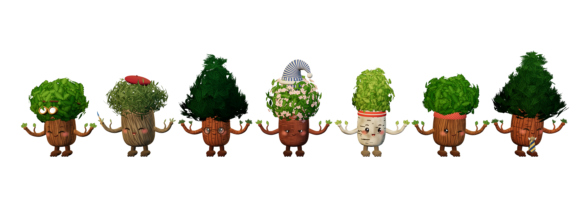
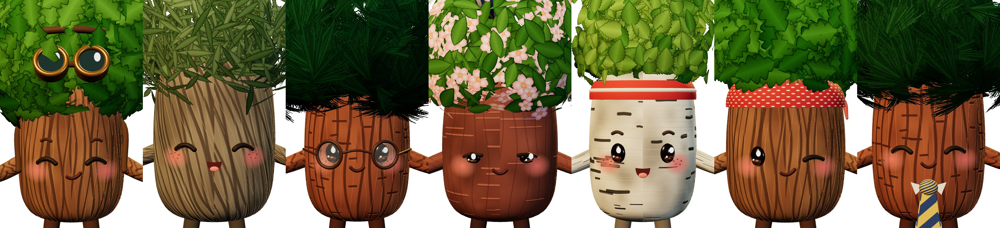
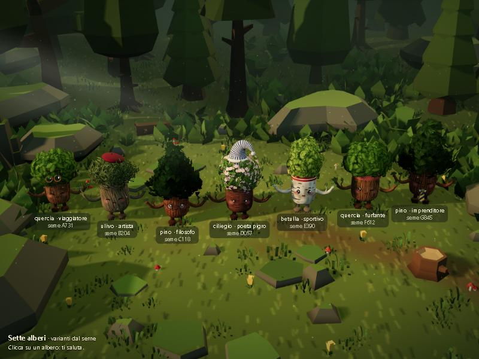
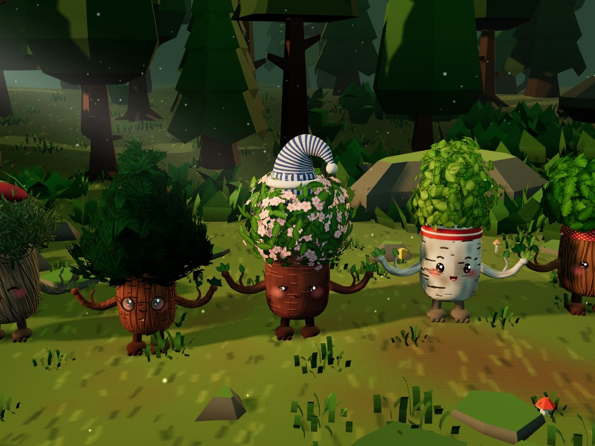

# Linfa — prototipo di stile 3D (foresta)

Bozza per far vedere lo stile grafico 3D: una radura vista dall'alto con Linfa
al centro, e una pagina con sette alberi diversi generati dal loro seme.
**Non è il prodotto** e non tocca il sito: tutto vive in questa cartella, senza
build e senza dipendenze da installare.



| Linfa da vicino | Linfa saluta |
|---|---|
|  |  |





| Sette alberi nella radura | Da vicino |
|---|---|
|  |  |

## Come aprirla

Serve un piccolo server statico (i moduli JS non partono da `file://`).
Dalla radice del repository:

```bash
npx serve prototipi/foresta-3d -l 4317
```

Poi, sulla porta 4317 (diversa dalla 3000 del sito):

| Pagina | Che cosa mostra |
|---|---|
| `/` | La radura con Linfa |
| `/varianti.html` | Sette alberi in fila, con specie, strada e seme |
| `/ritratto.html` | Ritratto di Linfa su sfondo trasparente, con il link «Scarica il PNG» |

- Clic su un albero: saluta (braccio-ramo in avanti, saltello, occhi sorridenti).
- Il mouse sposta appena la camera.
- `?vicino`: camera vicina agli alberi. `?foto`: tiene l'ultimo fotogramma nel
  canvas, solo per le catture.
- `ritratto.html?seme=A731&specie=quercia&strada=viaggiatore`: ritratto di un
  albero qualsiasi; `ritratto.html?fila`: i sette alberi in un solo PNG.
- In alto a destra: fotogrammi al secondo e chiamate di disegno.

Ritratti già pronti per la landing (PNG 1200×1500 con trasparenza):
`screenshot/linfa-ritratto.png` e `screenshot/linfa-ritratto-viaggiatore.png`.

## Linfa e le sue varianti

`linfa.js` costruisce l'albero in codice:

- **Tronco** tondo e morbido (profilo ruotato), con texture di corteccia dipinta
  su canvas: venature, nodi sui fianchi e rilievo (`bumpMap`).
- **Chioma** fatta di foglie vere: 800–1.500 foglie per albero in una sola
  `InstancedMesh`, con texture dipinta, raccolte in ciuffi; una frangia ricade
  sulla fronte. Luce morbida a palla e un fruscio leggero nello shader.
- **Viso «cucciolo»**: occhi piccoli, neri e lucidi (un riflesso grande e uno
  piccolo, un velo di marrone), bassi e distanti sul tronco con la fronte alta;
  niente bianco intorno agli occhi e niente ciglia. Guance rosa grandi e morbide,
  bocca piccola, sopracciglia piccole e alte oppure nessuna. Braccia-rami affusolate con mani di foglie, piedini
  con le dita-radici.
- **Animazione**: respiro, ciglia che sbattono, saluto al clic.

`creaLinfa(opzioni)` accetta i parametri; `generaOpzioni(seme)` li sceglie dal
seme dell'albero in modo deterministico (stesso seme, stesso albero):

| Parametro | Valori |
|---|---|
| `specie` | `quercia`, `pino`, `ulivo`, `betulla`, `ciliegio` (forma della chioma, foglia, corteccia; il ciliegio ha anche i fiori) |
| `altezza`, `larghezza` | proporzioni del tronco (0,9–1,14 e 0,88–1,12) |
| `viso` | `puntini` (occhi neri lucidi), `felice` (occhi chiusi ad arco ^ ^), `ridente` (^ ^ e bocca aperta), `assonnato` (palpebre pesanti), `furbetto` (occhiolino e sorriso storto). Il poeta pigro è sempre assonnato, il furfante sempre furbetto; per gli altri decide il seme fra puntini, felice e ridente |
| `sopracciglia` | `piccole` o `nessuna` |
| `lentiggini`, `bocca` | sì/no; `sorriso`, `aperta` (con la lingua) o `storto` (ridente, furbetto e assonnato hanno la loro) |
| `tono` | 0–1, il tono delle foglie dentro la specie |
| `strada` | `filosofo` (occhiali tondi), `artista` (basco e pennello), `sportivo` (fascia), `viaggiatore` (zaino e occhialoni), `imprenditore` (cravatta), `furfante` (bandana), `poeta-pigro` (berretto da notte), `nessuna` |

Nella pagina delle varianti (`fila.js`) specie, strada e viso sono fissati per
mostrarli tutti; proporzioni, sopracciglia, bocca e tono vengono dal seme.
`ritratto.html?fila&visi` fa il foglio di confronto dei visi.

## Che cosa c'è

| File | Che cosa fa |
|---|---|
| `index.html`, `varianti.html`, `ritratto.html` | Le tre pagine |
| `scena.js` | Radura: terreno dipinto, luci (sole radente, controluce caldo), nebbia, bosco in istanze, alberi-personaggio, clic |
| `linfa.js` | Il personaggio, le specie, le strade e il generatore dal seme |
| `texture.js` | Foglie, cortecce, guance e stoffe dipinte su canvas |
| `fila.js` | I sette alberi della pagina delle varianti |
| `modelli/kenney-nature-kit/` | I 22 modelli `.glb` del bosco, con la licenza originale |
| `vendor/three/` | three.js 0.187.0 (MIT), solo i file che servono |
| `LICENZE.md` | Fonti e licenze |

## Modelli del bosco (Kenney Nature Kit, CC0)

Alberi `tree_detailed_dark`, `tree_oak_dark`, `tree_fat_darkh`,
`tree_pineTallA_detailed`, `tree_pineRoundC`; ceppi `stump_oldTall`,
`stump_roundDetailed`; tronco `log_large`; rocce `rock_largeA`, `rock_largeC`,
`rock_tallB`, `rock_smallC`, `rock_smallFlatA`; cespugli `plant_bushDetailed`,
`plant_bushLarge`; felci e foglie `grass_leafsLarge`, `plant_flatTall`; erba
`grass_large`; funghi `mushroom_redGroup`, `mushroom_tanTall`, `mushroom_red`;
fiori `flower_yellowA`. Licenza CC0: vedi `LICENZE.md`. I colori originali sono
sostituiti in codice con una tavolozza profonda e satura.

## Velocità

- **Ombre precalcolate**: la mappa delle ombre del sole (4096²) si calcola una
  sola volta, alberi-personaggio compresi (il respiro non le sposta in modo
  visibile).
- **Istanze**: bosco e foglie in `InstancedMesh`; le foglie nascoste dentro la
  chioma non vengono create; le foglie usano un materiale Lambert, molto più
  leggero, perché sono tante e sovrapposte.
- **Misure** (pannello del browser di Claude, canvas 1536×1152, densità 1,5):

| Pagina | ms per fotogramma | Chiamate di disegno | Triangoli |
|---|---|---|---|
| Radura con un albero | ≈ 2,9 | 122 | ≈ 246 000 |
| Sette alberi | ≈ 4,7–5,6 | ≈ 600–630 | ≈ 520 000 |

  Prima di alleggerire le foglie, i sette alberi costavano 15–28 ms.

## Limiti

- Il bosco (Kenney) è low-poly a colori piatti: serve per luce e composizione.
- I personaggi sono fatti in codice: forme semplici e texture dipinte su canvas,
  non un modello d'artista con scolpitura e texture dipinte a mano.
